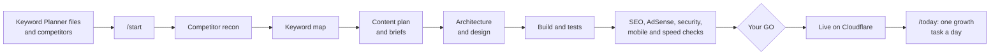

<div align="center">

# AK Site Kit

Turn your keyword research into a website built for Google search and AdSense.<br>
Claude Code agents do the work, automatic checks decide when each step is done, and you approve every launch.

[](../../actions/workflows/ci.yml)
[](../../actions/workflows/security.yml)


[Quick start](#quick-start) · [Step-by-step guide](#step-by-step-guide) · [Commands](#commands) ·
[Troubleshooting](#troubleshooting) · [FAQ](#faq) · [Handbook](docs/HANDBOOK.md)

</div>

Built with [Claude Code](https://code.claude.com). Not affiliated with or endorsed by Anthropic, Google or Cloudflare.

## Contents
- [What it is](#what-it-is)
- [How it works](#how-it-works)
- [Safety built in](#safety-built-in)
- [Features](#features)
- [Prerequisites](#prerequisites)
- [Quick start](#quick-start)
- [Step-by-step guide](#step-by-step-guide)
- [Commands](#commands)
- [What you get](#what-you-get)
- [Configuration](#configuration)
- [Project structure](#project-structure)
- [Keeping your site up to date](#keeping-your-site-up-to-date)
- [Status](#status)
- [Troubleshooting](#troubleshooting)
- [FAQ](#faq)
- [Glossary](#glossary)
- [Getting help](#getting-help)
- [Security](#security)
- [Contributing](#contributing)
- [Licence](#licence)
- [Acknowledgements](#acknowledgements)

Numbers in this README carry a tag: **[P]** is a starting default you can change in `factory.config.json`, and **[M]**
is measured, with where it came from.

## What it is
AK Site Kit is a GitHub template for people who want to build a content website that earns from search traffic. You
bring keyword ideas from Google Keyword Planner and a few competitor sites. A team of Claude Code agents, one for each
stage, turns them into a keyword map, a content plan, a design and then the site, and checks the result before it goes
live.

Every new site starts as its own copy of this template. Nothing is shared between sites, and nothing goes live without
your OK.

**It's for you if** you want to start a content site (guides, explainers, free tools) that earns from search and
AdSense, you're happy to work through Claude Code, and you'd rather follow a checked process than guess.

**It isn't for you if** you want an online shop or a web app with user accounts, a promise of rankings or AdSense
approval (nobody can give one), or a copy of a competitor's site.

## How it works


Each stage belongs to one agent. The agent writes a file, a script checks it, and the next stage starts only when the
check passes. Every result goes into a ledger (`reports/ledger.md`), so you can stop at any point and `/start` carries
on from there. In short: **agents propose, scripts decide, you approve.**

### The stages
| Stage | Agent | What you get | What decides it passed |
|---|---|---|---|
| Intake | orchestrator | Your domain, competitors and technology in `factory.config.json` | `/gate intake` |
| Competitor recon | competitor-recon | One map of each competitor's public pages | `/gate recon` |
| Keywords | keyword-researcher | The keyword map: one page per main keyword | `npm run research:all` |
| Content plan | content-strategist | Waves of pages and a brief for each page | `/gate strategy` |
| Growth plan | growth-strategist | 90 days of daily tasks | `/gate growth` |
| Architecture | architect | Technology, hosting, URL and link rules | `/gate architecture` |
| Design | designer | `docs/DESIGN.md`: colours, fonts and spacing as tokens | `/gate design` and `npm run gate:design` (contrast) |
| Build and tests | coder, harness | The site and its tests | `npm run verify` |
| Code review | code-reviewer | `reports/code-review.md` | Verdict PASS for that exact commit |
| Reviews | reconciler, seo-auditor, ai-search-auditor, adsense-gatekeeper, secops-reviewer, responsive-checker, performance-auditor | One report each in `reports/` | Each review's own scripts: the SEO gate, `gate:adsense`, the security checks, the e2e tests, Lighthouse |
| Pre-production | orchestrator | A pull request to `main` | `preprod.yml` green for that commit |
| GO | you | | You type `GO <commit>` in chat |
| Deploy | devsecops-deployer | The live site and a deploy report | `check:live` and `check:seo-live` on your domain |
| Docs | doc-generator | `docs/PRD.md`, `docs/ARCHITECTURE.md`, `docs/SECURITY.md` | `/gate docs` |

On a Cloudflare target, the cloudflare-reviewer also checks your zone before the GO. Every output file and command is in
[AGENTS.md → Gate table](AGENTS.md#4-gate-table).

## Safety built in
The agents follow the rules in [CLAUDE.md](CLAUDE.md). The ones below don't depend on an agent remembering them:
code enforces them.

| Rule | What enforces it |
|---|---|
| No secrets read, printed or committed (`.env*`, `.dev.vars*`, keys, tokens) | `.claude/hooks/guard.mjs` blocks it before Claude runs the tool; a secret scan runs after every edit (`.claude/hooks/post-edit.mjs`); `npm run check:repo` and gitleaks in CI |
| No push to `main`, no force-push, no skipped hooks | `guard.mjs`, and branch protection on `main` once you turn it on ([Setup](.github/CI-CD.md#setup-the-owner-once-per-project)) |
| Nothing deploys without your GO for that exact commit | `/deploy-production` waits for `GO <commit>` in chat; on a public repository, the `production` environment's required reviewer too |
| No ad code or `ads.txt` before AdSense approves your account | `npm run gate:adsense` |
| No stuffed, thin or duplicate pages | The SEO gate in every build ([docs/SEO-GATE.md](docs/SEO-GATE.md)) and `npm run audit:unique` |
| Only reviewed, pinned outside skills | `npm run check:skills`, which checks a hash for every file |
| No placeholder text on the site; exact dependency versions; no install scripts; nothing published less than 7 days ago | `npm run check:repo` and `.npmrc` |
| Free tools only | `factory.config.json` → `paidTools.allowed` is `false`; a step that needs a paid tool stops and asks you |

A few rules can't be fully checked by a script, so the agents carry them: never copy a competitor's text, images, code
or design; never invent facts, reviews or sources; never write to your Cloudflare, GitHub or Google accounts without a
yes in chat for that exact change.

## Features
- **Keyword research you can check.** Volumes come from your Keyword Planner files. Seasonal keywords and keywords too
  hard for a new site are dropped, with the reason recorded. Each keyword gets exactly one page, and pages carry a
  limit on secondary keywords, so nothing is stuffed.
- **Competitor analysis without copying.** For each competitor: its page types and templates, how the site is built,
  a feature matrix scored across all competitors, and what its readers complain about, all from public pages.
- **Content written for a reader.** Every page gets a brief with the reader's question, an outline, the sources to
  check and voice notes. Page text gets an editing pass that removes AI-writing patterns, and the SEO review flags any
  page that still reads as generated.
- **Search-ready structure.** One topic hub with its pages, at most three clicks deep, clean URLs, a sitemap, JSON-LD
  and `llms.txt`.
- **Ready for AI search.** A separate review checks what answer engines need (AEO and GEO): AI crawlers allowed by your
  bot policy, `llms.txt`, pages that answer the reader's question first, and facts with sources.
- **Every change reviewed.** A code reviewer reads each change before a pull request, checking your rules, the logic,
  the tests and security regressions, and the pipeline won't go on until its verdict is PASS for that exact commit.
- **AdSense rules built in.** The required pages, consent for Europe and the UK, and no ad code until your account is
  approved.
- **Security checks on every change.** Secret scanning and dependency and code scans run in CI. Once your site exists,
  previews also get ZAP scans and checks for XSS, path traversal, leaked private URLs and email spoofing.
- **Vetted skills.** The outside skills the agents use are found through Skillselion, must pass the skills.sh security
  audit (Gen Agent Trust Hub, Socket and Snyk), and are reviewed, pinned to a commit at least 7 days old and
  hash-checked in CI ([docs/SKILLS.md](docs/SKILLS.md)).
- **Free to run.** Free tools only. A step that would need a paid tool stops and asks you, with a free alternative.
- **Your choice of technology.** Next.js is built in; any tool that outputs plain HTML pages works.
- **A 90-day plan you can follow.** One task a day, 25 to 45 minutes [P], shown by `/today`.

## Prerequisites
| You need | Why | Check it with |
|---|---|---|
| A GitHub account | Your site lives in its own repository | |
| [Git](https://git-scm.com/downloads) | To download (clone) your copy | `git --version` |
| [Node.js](https://nodejs.org) 24 (24.22 or newer, below 25) | Runs the kit's scripts and tests | `node --version` |
| [Claude Code](https://code.claude.com/docs/en/setup) | Runs the agents | `claude --version` |
| A Claude plan that includes Claude Code | Pro, Max, Team, Enterprise or a Console account (the free claude.ai plan doesn't include Claude Code) | |
| A Google Ads account | Free access to Keyword Planner | |
| [Python](https://www.python.org/downloads/) 3, optional | The designer's style search and the competitor review ranking; without it the agents read the data directly | `python --version` |
| [Google Chrome](https://www.google.com/chrome/), optional | rea's deeper look at JavaScript-heavy competitor sites, in a throwaway profile ([docs/MCP.md](docs/MCP.md#enabled-with-limits-community-owner-approved)) | |
| Later: a Cloudflare account and a domain | To put the site online on the free plan | |

Install Claude Code with the official installer:

```bash
curl -fsSL https://claude.ai/install.sh | bash
```

On Windows PowerShell:

```powershell
irm https://claude.ai/install.ps1 | iex
```

Other options (Homebrew, WinGet, the desktop app) are in the [setup guide](https://code.claude.com/docs/en/setup).

## Quick start
1. On this repository's main page (the **Code** tab), click **Use this template → Create a new repository**. Use the
   template, not Fork: your site starts with a clean history. No button? See
   [Troubleshooting](#troubleshooting).
2. Clone your new repository and go into its folder:
   ```bash
   git clone https://github.com/<your-account>/<your-site>.git
   cd <your-site>
   ```
3. Install the exact versions the kit was tested with, then check the install:
   ```bash
   npm ci
   npm test
   ```
4. Start Claude Code in that folder (or open the folder in the desktop app) and accept the trust prompt:
   ```bash
   claude
   ```
5. Type `/start` and answer the questions.

`/start` remembers where you stopped. Run it again at any time to carry on.

## Step-by-step guide
Each step ends with a **Done when** line, so you know it worked before moving on.

### Step 1: Make your copy
Open this repository on GitHub, click **Use this template → Create a new repository**, and name it after your site.
GitHub copies the files into a new repository with a single commit, unlinked from this one.

**Public or private?** Public is recommended for a site you'll deploy. On GitHub Free, a private repository can't use
the `production` approval gate, environment secrets or branch protection, and it gets 2,000 Actions minutes a month
[M: docs.github.com, 2026-10-25] ([details](.github/CI-CD.md#private-repo-caveats-m-checked-on-docsgithubcom-2026-10-25)).
A public repository shows everything you commit, including the Keyword Planner files in `research/inputs/kp/`, so keep
those out of git if you go public.

**Done when:** the new repository is under your account.

### Step 2: Install
Clone the repository and run `npm ci` (see [Quick start](#quick-start)). `npm ci` installs exactly what
`package-lock.json` lists, and `.npmrc` blocks install scripts. To run the browser tests and the full
`npm run verify` on your machine, also install Playwright's browser once:

```bash
npx playwright install chromium
```

**Done when:** `npm ci` ends without an error and `npm test` passes.

### Step 3: Open it in Claude Code
Run `claude` in the folder, or open the folder in the Claude desktop app. Accept the trust prompt: it lets the
project's settings and safety hooks run (for example, the guard that stops anyone reading `.env` files or pushing to
`main`). Type `/` to see the kit's commands.

**Done when:** typing `/` lists `/start`.

### Step 4: Run `/start` and answer the intake questions
`/start` asks, in one message:
- **Your website:** its domain (bought or planned) and name.
- **Your competitors:** 2 to 5 websites, each with its Domain Rating (DR). Read DR from a free checker; the kit never
  looks it up or buys it.
- **Markets and language,** if they differ from the defaults.
- **Technology:** Next.js (built in) or another one, such as Astro, Eleventy or Hugo.

It saves your answers and picks the competitor with the **lowest DR** as the starting point. A weak site that still
ranks shows you keywords a new site can win.

**Done when:** `/gate status` shows intake as passed.

### Step 5: Download keyword ideas from Keyword Planner
`/start` tells you exactly what to do:
1. In Google Keyword Planner, choose **Discover new keywords → Start with a website**.
2. Enter the starting competitor's domain, choose **Use the entire site**, and set your location and language.
3. Download **Historical metrics** as CSV. Don't open it in Excel and save it as `.xlsx`.
4. Save it as `research/inputs/kp/<competitor-domain>.csv`. Files for other competitors are optional.
5. Tell Claude "CSVs are in".

While you do this, the competitor-recon agent maps each competitor's public pages: page types, structure and gaps.
It never copies their text or design. More detail: [research/inputs/README.md](research/inputs/README.md).

**Done when:** the file is in `research/inputs/kp/` and the keyword stage reads it without a format error.

### Step 6: Review the keyword map
The keyword stage reads your files and keeps keywords that pass every rule in `factory.config.json` → `research`:
- enough monthly searches (at least 1,000 [P]);
- not seasonal (the busiest month at most 2.5 times the median month [P]);
- not too hard (difficulty at most 30 [P], estimated from a free check of who ranks for it).

The rest are grouped into pages, one main keyword each, and every rejected keyword keeps its reason. You get the page
plan and the counts. If too few keywords survive, the agent shows why and asks you what to change.

**Done when:** `npm run research:all` passes and you've agreed to the page plan.

### Step 7: Plans and design
The next stages run one after another, each with its own check:
- **Content plan:** waves of pages (a hub and its first pages come first), a brief for each page, and the JSON-LD
  plan.
- **90-day growth plan:** one task a day.
- **Architecture:** the technology, hosting (Cloudflare Pages for a static site, Workers only if server code is
  needed; it asks you), URL rules and internal links.
- **Design:** colours, fonts and layout as design tokens in `docs/DESIGN.md`, checked for contrast.

**Done when:** `/gate status` shows strategy, growth, architecture and design as passed.

### Step 8: Build and check
The coder builds the pages from the briefs and the design, the harness writes their tests, and the code reviewer
checks the change. Then the reviews run: SEO, AI search, AdSense, security, responsive layouts from 320 to 1280 px, and
speed (Lighthouse: Accessibility, Best Practices and SEO 100 [P]; Performance at least 90 on mobile [P]). The Next.js
starter ships one example page of each type, which the coder replaces with your pages.

**Done when:** `npm run verify` passes, the code review says PASS for the current commit, and every review has its
report in `reports/`.

### Step 9: Go live
1. Set up Cloudflare and GitHub once: [.github/CI-CD.md → Setup](.github/CI-CD.md#setup-the-owner-once-per-project).
   It lists the two secrets and the variables by name, the `production` environment, the Cloudflare Pages settings and
   branch protection.
2. Open a pull request to `main`. The pre-production checks run on it.
3. When they pass, type `GO <commit>` in chat for that exact commit. Nothing deploys without it.
4. The kit deploys, checks the live site, and tells you how to roll back if anything is wrong.

**Done when:** `npm run check:live -- https://<your-domain>` and
`npm run check:seo-live -- https://<your-domain> / /contact/` both pass.

### Step 10: Grow, one task a day
Type `/today` to see today's task and your streak. `/today done` marks it done. `/today park <idea>` puts a new idea
in the parking lot instead of today's work, and no more than three tasks are ever in progress at once.

## Commands
### Slash commands (type them in Claude Code)
| Command | What it does |
|---|---|
| `/start` | Starts the pipeline or carries on where you stopped. `/start status` only shows progress. |
| `/gate status` | Shows which stages passed and what's next. `/gate <stage>` re-runs one stage's check. |
| `/keyword-pipeline` | Runs the keyword stage on its own: `check`, `kd`, `run` or `summary`. |
| `/today` | Today's growth task and streak: `done`, `skip`, or `park <idea>`. |
| `/deploy-production` | The launch loop: `preflight`, `deploy`, `verify`, `status`, `rollback` or `setup`. |

### npm scripts (run them in a terminal)
**Everyday**

| Command | What it does |
|---|---|
| `npm ci` | Installs the exact dependency versions, with install scripts blocked |
| `npm run dev` | Runs the site on your machine while you edit |
| `npm run build` | Builds the site, then checks the output and runs the SEO gate; any failure stops the build |
| `npm run serve` | Serves the built site the way Cloudflare does (headers, redirects, the 404 page) |
| `npm test` | Runs the unit tests (Vitest) |
| `npm run test:e2e` | Runs the browser tests (Playwright) against the built site |
| `npm run verify` | Runs everything a change must pass, in order: `check:skills`, `check:repo`, `audit`, `lint`, `typecheck`, `test`, `build`, `test:e2e` |

**Code and supply-chain checks**

| Command | What it does |
|---|---|
| `npm run lint` | ESLint, including the security rules in `eslint.config.mjs` |
| `npm run typecheck` | TypeScript type check |
| `npm run check:repo` | No secrets or `.env` files in git, no placeholder text on the site, the supply-chain settings in place |
| `npm run check:skills` | Every vendored skill matches its pinned hashes |
| `npm run audit` | Fails on any high or critical advisory that isn't a reviewed exception |
| `npm run check:release` | The content release rules on your real pages (fails on purpose on the template's example pages) |

**Site audits** (on the built site)

| Command | What it does |
|---|---|
| `npm run audit:seo` | The on-page SEO gate on every page ([docs/SEO-GATE.md](docs/SEO-GATE.md)) |
| `npm run audit:a11y` | Accessibility (axe-core, WCAG 2.2 A and AA) on every page |
| `npm run audit:perf` | Lab page speed against the Core Web Vitals budgets |
| `npm run audit:lighthouse` | Lighthouse CI against the score budgets |
| `npm run audit:unique` | How much of each page's text appears on no other page (stops near-duplicate pages) |
| `npm run gate:adsense` | The trust pages, no ad code or `ads.txt` before approval, and the other AdSense rules |
| `npm run gate:design` | WCAG AA contrast for every colour pair in `docs/DESIGN.md` |
| `npm run check:security -- <url>` | Security checks on a preview or your domain (`--static` checks only the build folder) |

**After a deploy**

| Command | What it does |
|---|---|
| `npm run check:live -- https://<domain>` | The live site as Google and a visitor see it: HTTPS, redirects, headers, DNS |
| `npm run check:seo-live -- https://<domain> / /contact/` | The SEO gate on live pages |
| `npm run audit:ga` | GA4 privacy and consent on the live site, without sending data to your property |

**Research and growth**

| Command | What it does |
|---|---|
| `npm run research:all` | Turns the Keyword Planner files into the keyword map, without Claude (`research:ingest`, `research:select`, `research:cluster`) |
| `npm run growth:today` | Today's task from the 90-day plan, and your streak |

## What you get
| File | What it holds |
|---|---|
| `research/out/keyword-map.json` | Every page to build, its main and secondary keywords, and the evidence |
| `research/out/selected.json` | The keywords kept, and every rejected one with its reason |
| `research/out/recon/*.md` | Each competitor's structure and gaps |
| `docs/CONTENT-STRATEGY.md`, `research/out/briefs/*.md` | The content plan and one brief per page |
| `docs/ARCHITECTURE.md` | Technology, hosting, URL and link rules |
| `docs/DESIGN.md` | The design as tokens a developer can apply exactly |
| `docs/GROWTH-90.md`, `growth/plan.json` | The 90-day plan |
| `reports/*.md` | The SEO, AdSense, security, responsive and speed reviews (kept on your machine; `reports/` is gitignored) |
| `reports/ledger.md` | Every check that ran, with its result |

## Configuration
Your project's settings live in `factory.config.json`. `/start` fills in the project; the rest are starting defaults
[P] you can change.

| Key | What it sets |
|---|---|
| `project` | Domain, name, language and markets |
| `competitors` | The competitors and the DR you gave |
| `build` | Technology, output folder and build commands |
| `hosting` | Cloudflare Pages (default) or Workers, and the production branch |
| `research` | Keyword rules: `minVolume` 1,000, `maxKd` 30, `maxSeasonality` 2.5, `maxSecondaryKeywordsPerPage` 10 [P] |
| `bots` | Search, AdSense and AI-search crawlers are allowed; AI-training crawlers are your choice |
| `budgets` | Lighthouse scores and Core Web Vitals limits: LCP 2.5 s or less, INP 200 ms or less, CLS 0.1 or less [P] |
| `paidTools.allowed` | `false`: no paid tools unless you change it |

Only you change the thresholds. An agent that thinks one should change asks you first.

## Project structure
```text
.claude/agents/       the agents, one file each
.claude/skills/       /start, /today, /gate, /keyword-pipeline, /deploy-production
.claude/hooks/        the guard (secrets, pushes to main) and the scan after every edit
vendor/skills/        reviewed outside skills the agents read, hash-checked
app/, components/,    the Next.js starter site
lib/, content/
public/               static files served as they are
research/inputs/      your Keyword Planner files and competitors.csv
research/out/         keyword map, briefs and recon (generated)
scripts/              the checks that decide (keyword pipeline, gates, audits)
tests/                unit tests (Vitest) and browser tests (tests/e2e, Playwright)
docs/                 handbook, contract, SEO gate, skills review, document templates
.github/workflows/    CI, security scans, Lighthouse, pre-production, deploy
factory.config.json   your project's settings
skills.lock.json      every outside skill, MCP server and GitHub Action, pinned
```

## Keeping your site up to date
A repository made from a template starts with its own history, so later changes to the kit don't reach your site by
themselves. To take one:
1. Read the kit's pull request for the change.
2. In your site's repository, create a branch and apply the same change: copy the changed files, or add the kit as a
   remote and `git cherry-pick` its commit.
3. Run `npm run verify` and open a pull request as usual.

Leave the files generated for your site alone (`factory.config.json`, `research/`, `content/pages/`, `docs/DESIGN.md`
and the other project docs): they're yours, not the kit's.

## Status
| Part | State |
|---|---|
| Agents, rules and the pipeline (`/start`, gates, ledger) | Ready |
| Keyword pipeline (Keyword Planner files → keyword map) | Ready, with tests |
| CI and security scans | Ready (site checks wait for a project; see [Template mode](.github/CI-CD.md#template-mode)) |
| Vetted skills | Ready |
| On-page SEO gate: 169 checks on every page, for keyword stuffing, thin pages, titles and trust links | Ready, with tests ([docs/SEO-GATE.md](docs/SEO-GATE.md)); runs once a site is built |
| Starter website (Next.js, one example page of each type) and the site checks | Ready, with tests ([docs/TODO-step-c.md](docs/TODO-step-c.md)) |
| `npm run lint` | Ready: ESLint 10 reads the code through TypeScript 6's API, alongside the TypeScript 7 compiler, until the lint rules support TypeScript 7 ([docs/TODO-step-c.md](docs/TODO-step-c.md#lint-on-typescript-7)) |

`/start` takes you from keyword research through the build, and `npm run verify` passes end to end (on the bare
template, with `SITE_URL=https://example.com`).

## Troubleshooting
**There's no "Use this template" button.** The button shows on the repository's main page (the **Code** tab), not on
pull request or settings pages. If it's missing there, the kit's owner has to tick **Settings → General → Template
repository** first.

**`npm ci` fails with an engine error.** The kit needs Node.js 24.22 or newer in the 24 line. Check with
`node --version`, install Node.js 24 from [nodejs.org](https://nodejs.org), then run `npm ci` again.

**`claude` isn't found after installing.** Open a new terminal window. If it still isn't found, run `claude doctor`, or
see [Fix your PATH](https://code.claude.com/docs/en/troubleshoot-install).

**`/start` doesn't appear.** Start Claude Code in the repository's root folder (the one with `CLAUDE.md`), accept the
trust prompt, and type `/` to see the list.

**A stage says BLOCKED.** The gate names what's missing and who provides it: you (a file, a number or a decision) or a
script. Run `/gate status` to see it again.

**The keyword stage says the file isn't a Keyword Planner export.** Download it again as CSV. A file opened in Excel
and saved as `.xlsx` can't be read.

**Very few keywords survive.** The researcher shows how many were dropped for each reason. Add another competitor's
file, or ask it to suggest a threshold change; only you edit the thresholds.

**The design stage can't find Python.** Python is optional. Install Python 3, or let the designer read the style data
directly.

**Claude stopped and asked about a paid tool.** That's on purpose: the kit uses free tools only. Say no and it offers a
free alternative, or say yes only if you're happy to pay for that tool.

**A `git push` was blocked.** The guard blocks pushes to `main`, force pushes and `--no-verify`. Push your branch
instead and open a pull request.

**`npm run build` says "seo-checks: no site URL".** The SEO gate won't guess your site's address. `/start` sets it
(`factory.config.json` → `project.domain`). Before that, or on the kit itself, give it a stand-in:
`SITE_URL=https://example.com npm run build` (in PowerShell: `$env:SITE_URL='https://example.com'; npm run build`).

**`npm run test:e2e` says a browser is missing.** Run `npx playwright install chromium` once, then try again.

**`npm run check:release` fails on a fresh copy.** That's expected: the template's example pages have no briefs. It
passes once your own pages replace them.

**Some CI jobs show as skipped.** That's template mode: site checks skip until `/start` sets a domain and the starter
site exists. Tests and security scans always run.

**`npm run check:skills` fails.** A file in `vendor/skills/` changed. Those files must match their reviewed copies
byte for byte: undo the change with `git checkout -- vendor/skills`, or update the skill properly
([docs/SKILLS.md](docs/SKILLS.md)).

## FAQ
**Should I fork it or use the template?** Use the template. Your site gets its own clean repository; a fork stays
linked to this one and shares its history.

**Should my site's repository be public or private?** Public, if you can. GitHub's free plan gives a public repository
the approval gate before a deploy, branch protection and secret scanning; a private one needs a paid plan for those.
See [Step 1](#step-1-make-your-copy).

**Does it cost anything?** The kit only uses free tools: Keyword Planner, GitHub Actions and Cloudflare's free plan.
Claude Code itself needs a Claude plan (Pro, Max, Team or Enterprise) or a Console account. Any step that would need a
paid tool stops and asks you first.

**What does Claude ask my permission for?** Deploying (your `GO` for the exact commit), any write to your Cloudflare,
GitHub or Google accounts, any paid tool, and switching ads on after AdSense approves you. Reads don't need a yes.

**Can I use something other than Next.js?** Yes. `/start` asks. Any tool that produces plain HTML pages works (for
example Astro, Eleventy or Hugo); the architect sets its build commands.

**Will this get my site approved for AdSense, or ranked?** Nobody can promise that; Google decides. The kit checks the
things that commonly cause rejections, such as missing pages, thin or copied content, missing consent and ad code added
too early, and it gets the SEO basics right.

**Where does keyword difficulty come from?** Keyword Planner doesn't measure SEO difficulty. Its "Competition" column
is about advertisers bidding. The kit estimates difficulty from a free look at who ranks, marks it as an estimate, and
uses your own numbers when you add them.

**Why do I have to type the competitors' DR?** DR is a paid metric. You can read it from a free checker; the kit never
scrapes it or pays for it.

**Will it copy my competitors?** No. It studies the structure and gaps of their public pages, and never copies text,
images, code or design.

**Are the outside skills safe?** Each one was read file by file, is pinned to a commit at least 7 days old, and is
stored in `vendor/skills/` with a hash for every file that CI checks. Skills that failed review are listed with the
reasons in [docs/SKILLS.md](docs/SKILLS.md).

## Glossary
| Term | Meaning |
|---|---|
| Agent | A Claude Code helper with one job, defined in `.claude/agents/` |
| Stage | One step of the pipeline, owned by one agent |
| Gate | The script or CI job that decides whether a stage passed |
| Ledger | `reports/ledger.md`: every gate run and its result, so `/start` can carry on |
| GO | Your approval to deploy one exact commit, typed in chat as `GO <commit>` |
| DR (Domain Rating) | A score for how strong a site's backlinks are; you read it from a free checker |
| KD (keyword difficulty) | How hard it is to reach Google's first page for a keyword; estimated, never paid for |
| Hub | A topic's main page, which links to every page in that topic |
| Wave | A group of pages built together; wave 1 is the hub and its first pages |
| Brief | A page's plan: the reader's question, an outline, sources to check and voice notes |
| Trust pages | About, Contact, Privacy, Terms and Editorial policy, plus an author page |
| JSON-LD | Structured data in a page that tells search engines what the page is about |
| `llms.txt` | A plain-text guide to the site for AI tools |
| AEO and GEO | Answer and generative engine optimisation: being found and quoted by AI search |
| Core Web Vitals | Google's speed measures: LCP (loading), INP (response to input) and CLS (layout shift) |
| Template mode | CI skips the site checks until your project exists |
| Vendored skill | An outside skill copied into `vendor/skills/` after review, and hash-checked |

## Getting help
1. Check [Troubleshooting](#troubleshooting) and the [FAQ](#faq).
2. Ask Claude in your project: `/gate status`, or "why did the seo stage fail?".
3. Read the reference docs: [docs/HANDBOOK.md](docs/HANDBOOK.md) for how everything works,
   [.github/CI-CD.md](.github/CI-CD.md) for CI and deploys, [docs/SEO-GATE.md](docs/SEO-GATE.md) for SEO gate
   failures.
4. Still stuck? Open an issue on the kit's repository with the command you ran, its output and the commit
   (`git rev-parse --short HEAD`). Never paste a secret, token or key.

## Security
To report a vulnerability in the kit, follow [SECURITY.md](SECURITY.md): report it privately with **Security → Report
a vulnerability**, never in a public issue. A site built from the kit gets its own `docs/SECURITY.md`, written by the
secops-reviewer agent.

## Contributing
1. Create a branch from `main` (`git switch -c fix/<short-name>`). Never commit or push to `main`.
2. Make the change. [docs/CONTRACT.md](docs/CONTRACT.md) says which part of the kit owns each file.
3. Run `npm run verify` (run `npx playwright install chromium` once first). The kit itself has no domain, so give the
   build a stand-in one, as in [Troubleshooting](#troubleshooting):
   ```bash
   SITE_URL=https://example.com npm run verify
   ```
4. Commit with a short conventional message, as the history does: `fix(lint): …`, `feat(skills): …`, `docs(readme): …`.
5. Open a pull request. CI has to pass and the code owner reviews it before it's merged.

Three rules for every change: don't loosen a gate to make it pass, add an npm dependency only with the supply-chain
checklist in [CLAUDE.md](CLAUDE.md), and change a vendored skill only through the review in
[docs/SKILLS.md](docs/SKILLS.md). The rules the agents follow are in [CLAUDE.md](CLAUDE.md) and
[AGENTS.md](AGENTS.md).

## Licence
No licence has been chosen yet. Until one is added, normal copyright applies: you can read this repository, but
reusing it needs the author's permission. The skills in `vendor/skills/` keep their own licences (MIT, Apache-2.0 or
CC BY-SA 4.0), included in each folder.

## Acknowledgements
The agents read skills by Corey Haines (marketingskills), agricidaniel (claude-seo), aaron-he-zhu
(aaron-marketing-skills), Siqi Chen (humanizer), Next Level Builder (UI UX Pro Max), Jake Schincariol (Replica), morluto
(REA), Addy Osmani, Trail of Bits, Sentry, Vercel, Anthropic and Cloudflare. The full list, with versions and licences,
is in [docs/SKILLS.md](docs/SKILLS.md).
